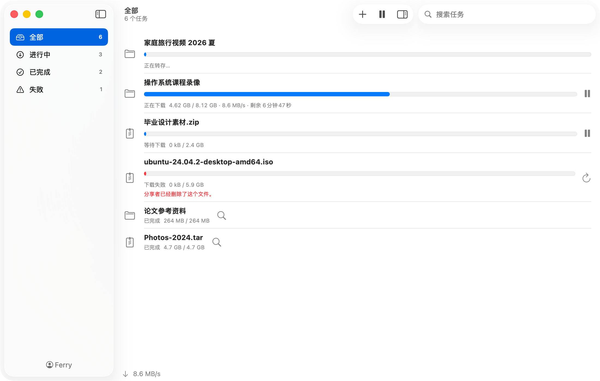

# Ferry

[](https://github.com/yiquncode/BaiduPCS-Swift/releases/latest)

[](LICENSE)
[](https://ferry.lemmabyte.com)

Ferry 是 Swift 编写的 macOS 原生百度网盘下载工具，运行时占用的资源很少。本软件不能提速，下载速度和官方客户端相同，由账号的会员等级决定。

<picture>
  <source media="(prefers-color-scheme: dark)" srcset=".github/screenshot-dark.png">
  
</picture>

## 功能

- **下载分享链接**：复制分享链接后切换到 Ferry 打开分享。
- **从我的网盘下载**：勾选自己网盘中的文件和目录，直接下载。
- **无服务器**：Cookie 凭据存在 macOS Keychain 中，不经过第三方。

## 系统要求

- macOS 14 或更高版本
- 构建需要 Xcode 26（Swift 6.2）

## 安装

从 [Releases](https://github.com/yiquncode/BaiduPCS-Swift/releases/latest) 下载 `Ferry-<版本>.zip`，解压后把 Ferry 拖到“应用程序”文件夹。

Ferry 没有经过 Apple 公证。第一次打开时，macOS 不让它运行。打开“系统设置 → 隐私与安全性”，在“安全性”中点击“仍要打开”。

## 项目结构

```
BaiduPCS-Swift/          Ferry.app：SwiftUI 界面、Keychain、下载目录权限、应用生命周期
Packages/FerryKit/
├── FerryCore            任务流程：任务模型、任务列表、JobCoordinator、设置
├── BaiduKit             百度协议：凭据、分享、转存、网盘操作、下载链接
└── DownloadKit          通用分片下载：分片、并发、断点续传、进度持久化
```

## 致谢

百度网盘接口的用法参考了 [BaiduPCS-Go](https://github.com/qjfoidnh/BaiduPCS-Go)。

## 许可证

[Apache License 2.0](LICENSE)
